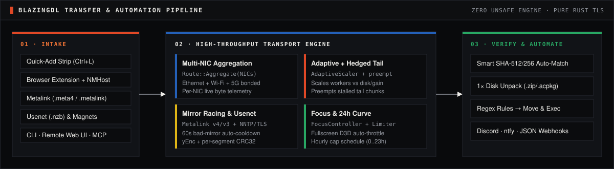

<p align="center">
  
</p>

<p align="center">
  <a href="https://github.com/Khuraie/BlazingDL/releases"></a>
  <a href="LICENSE"></a>
  
  
</p>

<p align="center">
  <a href="#desktop-showcase">Showcase</a> ·
  <a href="#key-features">Features</a> ·
  <a href="#engine-pipeline">Architecture</a> ·
  <a href="#quick-add--shortcuts">Quick-Add</a> ·
  <a href="#power-user-configuration">Configuration</a> ·
  <a href="#building-from-source">Build</a>
</p>

---

**BlazingDL** is a native Rust download manager built for raw throughput and clean control. It pairs a zero-bloat segmented transfer engine (Multi-NIC bonding, adaptive concurrency, hedged tail racing, Metalink multi-mirror racing, BitTorrent, and native Usenet `.nzb`) with the **Saville Catalog Pulse** desktop shell — an absorbent matte-black workstation driven by a live 5-line pulsar throughput waveform.

## Desktop Showcase

<p align="center">
  
</p>

<p align="center">
  <em>Real hardware-rendered capture of BlazingDL running the <strong>Saville Catalog Pulse</strong> shell — 86px Pulse Header, 36px inline Command &amp; Capture Strip, Catalog Index Rail, double protocol color blocks, and 2px inline progress hairlines.</em>
</p>

> Prefer a classic desktop aesthetic? **Classic, Metro, Adwaita, Breeze, Luna, Aero, Aqua, Emerald, High Contrast, and Native** themes remain one click away under **View → Theme**.

---

## Key Features

<table>
  <tr>
    <td width="50%" valign="top">
      <h3>⚡ Plexo-Style Multi-NIC Aggregation</h3>
      Bond multiple active network adapters (e.g. <strong>Ethernet + Wi-Fi + 5G USB tethering</strong>) across concurrent download workers via <code>Route::Aggregate</code>. One click on the <strong>MULTI-NIC</strong> pill bonds all active interfaces and surfaces live per-NIC telemetry in the Pulse Header.
    </td>
    <td width="50%" valign="top">
      <h3>🏎️ Adaptive Streams &amp; Hedged Tail Racing</h3>
      <code>AdaptiveScaler</code> adjusts concurrency against real throughput gain and disk pressure, while <code>Planner::preempt_slow_tail</code> lets fast workers preempt sluggish straggler tails with anti-livelock cooldowns so one bad TCP route never stalls the last 5%.
    </td>
  </tr>
  <tr>
    <td width="50%" valign="top">
      <h3>🌐 Multi-Mirror Racing &amp; Metalink</h3>
      Drop or paste any RFC 5854 <code>.meta4</code> or v3 <code>.metalink</code> manifest to race byte ranges across all mirrors in parallel. Failing mirrors enter an automatic 60-second cooldown while healthy mirrors finish the file and verify the strongest declared checksum.
    </td>
    <td width="50%" valign="top">
      <h3>📰 Native Usenet (<code>.nzb</code>) Engine</h3>
      Pure-Rust NZB XML parser, streaming yEnc decoder with per-segment CRC32 verification, and multi-connection async NNTP/NNTPS (<code>tokio-rustls</code>) downloader built directly into <code>blazingdl-engine::nzb</code>.
    </td>
  </tr>
  <tr>
    <td width="50%" valign="top">
      <h3>🔐 Smart Checksums &amp; Webhooks</h3>
      Paste a URL alongside a SHA-512/256/1/MD5 hash (or drop a sibling <code>SHA256SUMS</code> / <code>.sha256</code> file) to auto-match integrity checks. Post-download regex/category rules automatically move files, run shell command templates, or push <strong>Discord, ntfy, and JSON webhooks</strong>.
    </td>
    <td width="50%" valign="top">
      <h3>🎮 Game / Focus Mode &amp; 24h Curve</h3>
      Click the <strong>FOCUS</strong> pill to auto-throttle downloads whenever a fullscreen Direct3D game or presentation is active (<code>SHQueryUserNotificationState</code>), or define a 24-hour bandwidth schedule curve. Always enforces the tightest cap without overwriting manual Speed Limiter settings.
    </td>
  </tr>
  <tr>
    <td width="50%" valign="top">
      <h3>🧲 BitTorrent, Video &amp; Browser Capture</h3>
      Full <code>librqbit</code> BitTorrent engine (magnets, DHT, uTP, selective files, blocklists), signature-verified <code>yt-dlp</code> / <code>gallery-dl</code> / <code>ffmpeg</code> helpers, and a cross-browser native messaging extension for Chrome, Edge, Brave, Firefox, and Safari.
    </td>
    <td width="50%" valign="top">
      <h3>🤖 CLI, Remote Web UI &amp; MCP Server</h3>
      Drive BlazingDL from anywhere: headless CLI (<code>blazingdl-cli</code>), local HTTPS phone/remote web UI (<code>blazingdl-remote</code>), Click'n'Load (<code>blazingdl-cnl</code>), Debrid hosts (<code>blazingdl-debrid</code>), and a stdio <strong>MCP server</strong> (<code>blazingdl-mcp</code>) for AI coding assistants.
    </td>
  </tr>
</table>

---

## Engine Pipeline

<p align="center">
  
</p>

---

## Quick-Add & Shortcuts

The inline **Command & Capture Strip** sits flush beneath the Pulse Header and accepts everything in one box:

| Input / Shortcut | What BlazingDL Does |
| :--- | :--- |
| **`Ctrl + L`** | Focus the inline Quick-Add bar (`Enter` or **GO** submits) |
| **`Ctrl + F`** | Focus the live instant transfer filter (`×` clears) |
| **`https://…/file.iso`** | Starts a segmented HTTP/HTTPS/FTP download |
| **`https://…/file.iso sha256:<hex>`** | Starts download **and** attaches the auto-matched SHA-256 checksum |
| **`magnet:?xt=urn:btih:…`** or **`.torrent`** | Opens the BitTorrent transfer dialog with selective file picker |
| **`C:\path\to\distro.meta4`** | Parses Metalink mirrors + strongest hash and races all mirrors in parallel |
| **`C:\path\to\release.nzb`** | Launches multi-connection NNTP/yEnc Usenet download into your downloads folder |
| **MULTI-NIC pill** | One-click toggle to bond all active IPv4/IPv6 network adapters |
| **FOCUS pill** | One-click toggle for fullscreen game/presentation auto-throttling |

---

## Power-User Configuration

Settings persist cleanly in `%APPDATA%\blazingdl\downloads.json` (Windows) or `~/.config/blazingdl/downloads.json` (Linux/macOS).

<details>
<summary><strong>Post-Download Automation Rules &amp; Webhooks (Discord / ntfy / JSON)</strong></summary>

```json
"automation_rules": [
  {
    "name": "Move ISOs and ping Discord",
    "enabled": true,
    "pattern": "\\.iso$",
    "category": "Programs",
    "move_to": "D:/ISO-Library",
    "run_command": "echo Verified {file} ({size} bytes) at {path}",
    "webhook_url": "https://discord.com/api/webhooks/YOUR_ID/YOUR_TOKEN"
  },
  {
    "name": "Mobile push on all completions",
    "enabled": true,
    "pattern": "",
    "webhook_url": "https://ntfy.sh/my-blazingdl-topic"
  }
]
```
Supported command placeholders: `{path}`, `{file}`, `{dir}`, `{url}`, `{size}`, `{category}`.

</details>

<details>
<summary><strong>Game / Focus Auto-Throttle &amp; 24-Hour Bandwidth Curve</strong></summary>

```json
"focus_mode": {
  "enabled": true,
  "throttle_kbps": 2048,
  "detect_fullscreen": true,
  "hourly_curve_kbps": [
    null, null, null, null, null, null,
    null, null, null, 4096, 4096, 4096,
    4096, 4096, 4096, 4096, 4096, 2048,
    2048, 2048, 2048, 2048, 4096, null
  ]
}
```
Array indices `0..23` correspond to local hours (`null` = unlimited, integer = KB/s cap).

</details>

<details>
<summary><strong>Usenet NNTP / NNTPS Server Configuration</strong></summary>

```json
"nntp": {
  "host": "news.example.com",
  "port": 563,
  "tls": true,
  "username": "your-user",
  "password": "your-password",
  "connections": 12
}
```

</details>

---

## Workspace Architecture

| Crate | Binary / Role |
| :--- | :--- |
| `blazingdl-app` | `blazingdl` — Native desktop GUI (`egui`, Saville Catalog Pulse + 10 built-in themes) |
| `blazingdl-cli` | `blazingdl-cli` — Headless command-line launcher |
| `blazingdl-nmhost` | `blazingdl-nmhost` — Browser native messaging host (`com.blazingdl.host`) |
| `blazingdl-mcp` | `blazingdl-mcp` — Model Context Protocol (MCP) stdio server |
| `blazingdl-engine` | Segmented HTTP/FTP, Multi-NIC `Route::Aggregate`, Metalink, NZB/yEnc, adaptive/hedged tail core |
| `blazingdl-torrent` | BitTorrent & magnet session engine (`librqbit`) |
| `blazingdl-ipc` | Local single-instance IPC channel & automation API schema |
| `blazingdl-tools` | Signature-verified helper tool installer & self-update verification |
| `blazingdl-remote` | Local HTTPS remote control server & web UI |
| `blazingdl-extract` | Built-in ZIP/tar/xz extraction & archive integrity checker |
| `blazingdl-crash` | Crash/freeze monitor & minidump symbolicator (`blazingdl-symbolicate`) |
| `blazingdl-debrid`, `blazingdl-cnl`, `blazingdl-geo`, `blazingdl-labserver` | Debrid hosts, Click'n'Load, offline IP-to-country, fault-injection lab server |

---

## Building from Source

Requires **Rust 1.98+** (Edition 2024).

```powershell
# Desktop app + CLI + Native Host + MCP server (pure Rust TLS; zero C/BoringSSL build prereqs)
cargo build -p blazingdl-app -p blazingdl-cli -p blazingdl-nmhost -p blazingdl-mcp --no-default-features

# Full build including `browser-connection` (BoringSSL TLS impersonation; requires CMake, libclang, NASM on Windows)
cargo build --workspace

# Run engine, app, workspace & extension test suites
cargo test -p blazingdl-engine --no-default-features --lib
cargo test -p blazingdl-engine --no-default-features --test blazing_features
cargo test -p blazingdl-app --no-default-features --bin blazingdl "palette::tests|list::tests|automation::tests|focusmode::tests|default_apps_tests"
cargo test -p blazingdl-ipc -p blazingdl-mcp -p blazingdl-nmhost
cargo test -p blazingdl-tools --no-default-features --lib
node tools/extension/test.mjs
```

### Packaging & Assets

- **Browser extension** (Chromium, Firefox, Safari): `tools/extension/pack.ps1` → `target/extension/`
- **Windows installer & portable zips** (Inno Setup 6): `tools/installer/build.ps1` → `target/dist/`
- **Regenerate app & extension icons** from `art/BlazingDL.png`: `python tools/icon/build_icon.py`

---

## License & Attribution

Licensed under the **GNU General Public License v3.0 or later** ([LICENSE](LICENSE)).

BlazingDL is a fork of [Mister Download Manager](https://github.com/anefzaoui/misterdownloadmanager) by Ahmed Nefzaoui, with Multi-NIC bandwidth aggregation inspired by [Plexo](https://github.com/anmolkapil/plexo). See [ATTRIBUTION.md](ATTRIBUTION.md) for full upstream and third-party asset credits.
