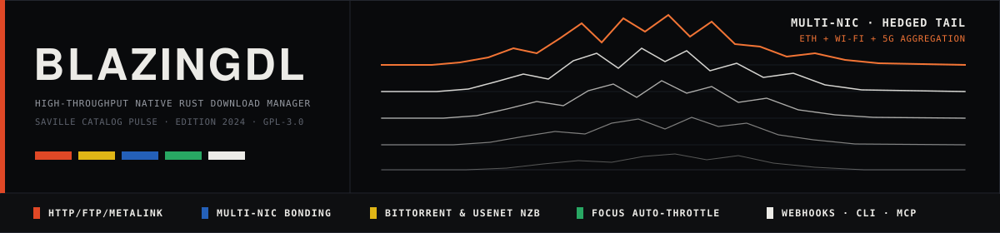
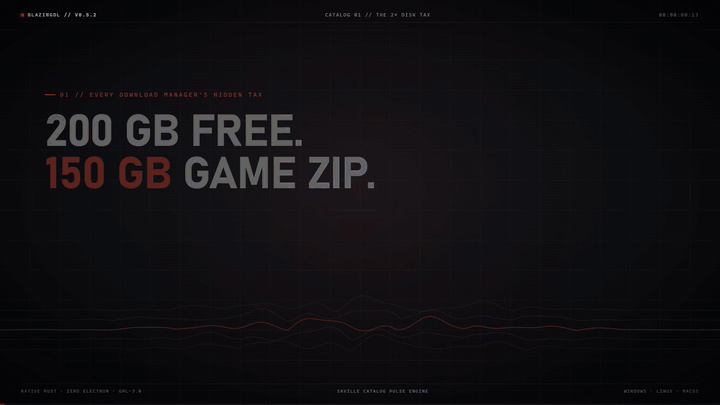
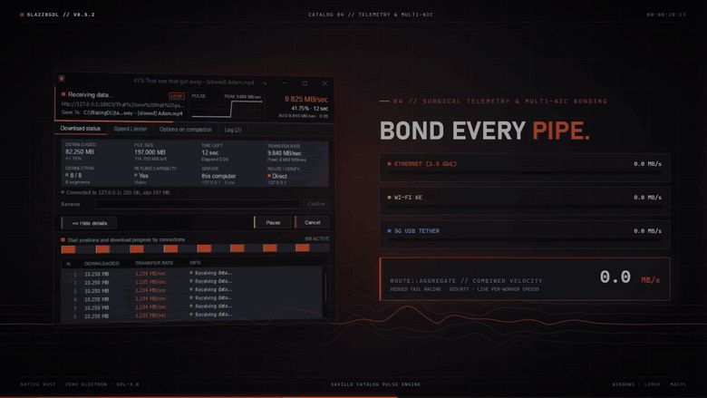
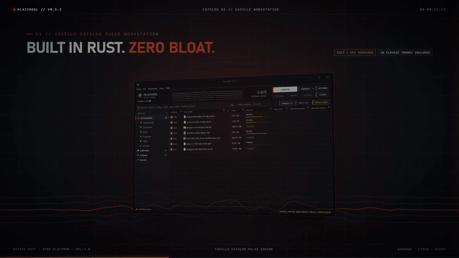
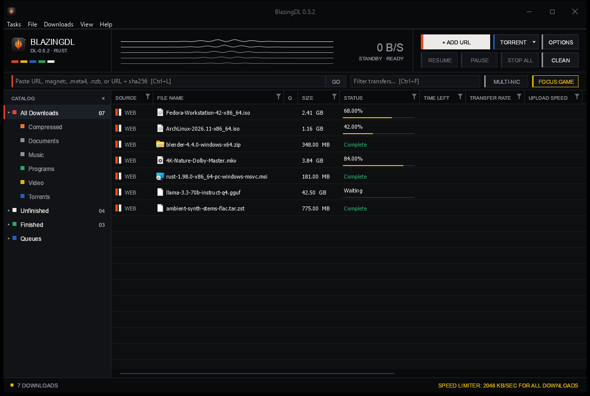
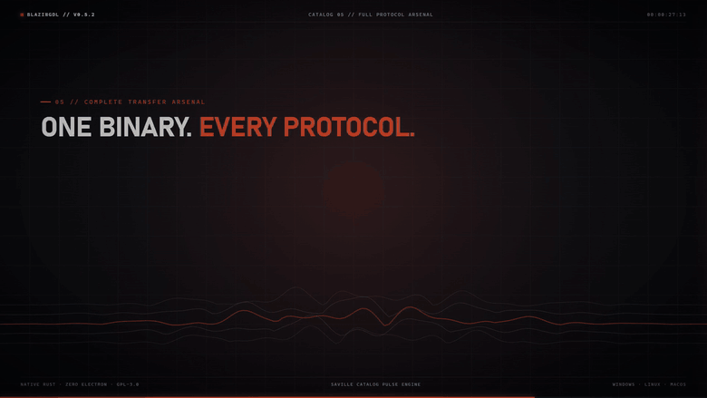

<p align="center">
  
</p>

<p align="center">
  <a href="https://github.com/Khuraie/BlazingDL/releases"></a>
  <a href="LICENSE"></a>
  
  
</p>

<p align="center">
  <a href="#1-disk-stream-unpack-300-gb">1× Disk Unpack</a> ·
  <a href="#multi-nic-bonding--telemetry">Multi-NIC</a> ·
  <a href="#desktop-showcase">Showcase</a> ·
  <a href="#key-features">Features</a> ·
  <a href="#engine-pipeline">Architecture</a> ·
  <a href="#quick-add--shortcuts">Quick-Add</a> ·
  <a href="#current-beta-limitations">Limitations</a> ·
  <a href="#building-from-source">Build</a>
</p>

---

**BlazingDL** is a native Rust download manager built for raw throughput and clean control. It pairs a zero-bloat segmented transfer engine (300+ GB 1× disk streaming unpack, Multi-NIC bonding, adaptive concurrency, hedged tail racing, Metalink multi-mirror racing, BitTorrent, and native Usenet `.nzb`) with the **Saville Catalog Pulse** desktop shell.

> **Full 1080p60 Launch Promo (0:36 · 48 kHz stereo):** [BlazingDL-Promo-1080p60.mp4](https://github.com/Khuraie/BlazingDL/releases/download/v0.5.2/BlazingDL-Promo-1080p60.mp4)

---

## 1× Disk Stream Unpack (300+ GB)

Have **200 GB free** and a **150 GB game `.zip`**? Legacy downloaders save the archive first and crash at 2× disk space. BlazingDL never saves the `.zip` to disk — it reads the Central Directory over HTTP `Range`, streams files straight into a ready-to-play folder in `<512 KiB`/worker RAM, and leaves **50 GB free**.

<p align="center">
  <a href="https://github.com/Khuraie/BlazingDL/releases/download/v0.5.2/BlazingDL-Promo-1080p60.mp4">
    
  </a>
</p>

- **300+ GB ZIP64 & Parallel `STORE` Slicing:** splits huge `STORE` entries across up to 8 concurrent Range / Multi-NIC streams with **O(1) instant Pause → Resume** and `crc32fast` combine verification.
- **Works Everywhere:** triggers across Quick-Add, `+ ADD URL`, and Browser captures (including extensionless signed CDN links), inheriting Cookies, Auth, Proxy/PAC, DNS, and automatic mid-stream TCP reconnects.
- **Zero Breakage:** if a server ignores HTTP `Range` or serves an encrypted ZIP, BlazingDL transparently falls back to a standard download. Also streams `.tar` (Range-resumable), `.tar.gz`/`.tar.xz`/`.tar.zst`, and `.acpkg` v1.

<details>
<summary><strong>Verified live GitHub CDN run — 507 MiB extracted, 0 B .zip on disk, 20.6 MiB peak RAM</strong></summary>

Measured directly against a real public GitHub Release asset ([`ffmpeg-master-latest-win64-gpl.zip`](https://github.com/BtbN/FFmpeg-Builds/releases/download/latest/ffmpeg-master-latest-win64-gpl.zip), 8 workers, Windows x64 release build):

| Metric | Measured | Standard downloader + unzip |
| :--- | ---: | ---: |
| Remote `.zip` over HTTPS | `196.05 MiB` (`205,571,641 B`) | `196.05 MiB` |
| Extracted output (44 files, CRC32-verified) | `507.21 MiB` (`531,850,158 B`) | `507.21 MiB` |
| Peak disk usage (`.zip` bytes written) | **`507.21 MiB`** (`0 B` `.zip`) | `703.26 MiB` (`196.05 MiB` `.zip` + extracted) |
| Peak process RAM (`PeakWorkingSet64`) | **`20.62 MiB`** | — |
| Elapsed time (wire → ready on disk) | **`20.67 s`** (`9.48 MiB/s` wire / `24.54 MiB/s` extracted) | Download + separate extraction pass |

Reproduce on your own machine with [crates/extract/examples/live_unpack.rs](crates/extract/examples/live_unpack.rs):

```bash
cargo run --release -p blazingdl-extract --example live_unpack -- \
  https://github.com/BtbN/FFmpeg-Builds/releases/download/latest/ffmpeg-master-latest-win64-gpl.zip \
  ./ffmpeg-out 8
```

</details>

---

## Multi-NIC Bonding & Telemetry

Bond **Ethernet + Wi-Fi 6E + 5G USB tethering** simultaneously via `Route::Aggregate` while monitoring live throughput sparklines, 2×4 telemetry metrics, server Geo/RTT, and per-worker speeds in the **Saville Download Progress Window**.

<p align="center">
  <a href="https://github.com/Khuraie/BlazingDL/releases/download/v0.5.2/BlazingDL-Promo-1080p60.mp4">
    
  </a>
</p>

---

## Desktop Showcase

<p align="center">
  <a href="https://github.com/Khuraie/BlazingDL/releases/download/v0.5.2/BlazingDL-Promo-1080p60.mp4">
    
  </a>
</p>

<details>
<summary><strong>View full-resolution static desktop capture (Saville Catalog Pulse)</strong></summary>
<p align="center">
  
</p>
</details>

<p align="center">
  <em><strong>Saville Catalog Pulse</strong> — 86px Pulse Header, 36px inline Command &amp; Capture Strip, Catalog Index Rail, double protocol color blocks, 2px inline progress hairlines, matching Saville Progress Window, and Saville-styled browser extension.</em>
</p>

> Prefer a classic desktop aesthetic? **Classic, Metro, Adwaita, Breeze, Luna, Aero, Aqua, Emerald, High Contrast, and Native** themes remain one click away under **View → Theme**.

---

## Key Features

<p align="center">
  <a href="https://github.com/Khuraie/BlazingDL/releases/download/v0.5.2/BlazingDL-Promo-1080p60.mp4">
    
  </a>
</p>

<table>
  <tr>
    <td width="50%" valign="top">
      <h3>01 / Multi-NIC Aggregation</h3>
      Bond multiple active network adapters (e.g. <strong>Ethernet + Wi-Fi + 5G USB tethering</strong>) across concurrent download workers via <code>Route::Aggregate</code>. One click on the <strong>MULTI-NIC</strong> pill bonds all active interfaces and surfaces live per-NIC telemetry in the Pulse Header.
    </td>
    <td width="50%" valign="top">
      <h3>02 / Adaptive Streams &amp; Hedged Tail Racing</h3>
      <code>AdaptiveScaler</code> adjusts concurrency against real throughput gain and disk pressure, while <code>Planner::preempt_slow_tail</code> lets fast workers preempt sluggish straggler tails with anti-livelock cooldowns so one bad TCP route never stalls the last 5%.
    </td>
  </tr>
  <tr>
    <td width="50%" valign="top">
      <h3>03 / Multi-Mirror Racing &amp; Metalink</h3>
      Drop or paste any RFC 5854 <code>.meta4</code> or v3 <code>.metalink</code> manifest to race byte ranges across all mirrors in parallel. Failing mirrors enter an automatic 60-second cooldown while healthy mirrors finish the file and verify the strongest declared checksum.
    </td>
    <td width="50%" valign="top">
      <h3>04 / Native Usenet (<code>.nzb</code>) Engine</h3>
      Pure-Rust NZB XML parser, streaming yEnc decoder with per-segment CRC32 verification, and multi-connection async NNTP/NNTPS (<code>tokio-rustls</code>) downloader built directly into <code>blazingdl-engine::nzb</code>.
    </td>
  </tr>
  <tr>
    <td width="50%" valign="top">
      <h3>05 / Smart Checksums &amp; Webhooks</h3>
      Paste a URL alongside a SHA-512/256/1/MD5 hash (or drop a sibling <code>SHA256SUMS</code> / <code>.sha256</code> file) to auto-match integrity checks. Post-download regex/category rules automatically move files, run shell command templates, or push <strong>Discord, ntfy, and JSON webhooks</strong>.
    </td>
    <td width="50%" valign="top">
      <h3>06 / Game / Focus Mode &amp; 24h Curve</h3>
      Click the <strong>FOCUS</strong> pill to auto-throttle downloads whenever a fullscreen Direct3D game or presentation is active (<code>SHQueryUserNotificationState</code>), or define a 24-hour bandwidth schedule curve. Always enforces the tightest cap without overwriting manual Speed Limiter settings.
    </td>
  </tr>
  <tr>
    <td width="50%" valign="top">
      <h3>07 / 300+ GB 1× Disk Stream Unpack</h3>
      Pure-Rust streaming unpack (wire-compatible with <a href="https://github.com/Khuraie/AntiCompress">Khuraie/AntiCompress</a>) across <strong>Quick-Add, + ADD URL, and Browser captures</strong> (even extensionless signed CDN links): streams remote <code>.zip</code> / <strong>ZIP64 (&gt;300 GiB)</strong> in &lt;512 KiB/worker RAM (Store, Deflate, Zstd), splits huge ZIP <code>STORE</code> files across parallel Range/Multi-NIC streams with <strong>O(1) instant Pause → Resume</strong> and <code>crc32fast</code> combine verification, streams <code>.tar</code> (Range-resumable) / <code>.tar.gz</code> / <code>.tar.xz</code> / <code>.tar.zst</code> and <code>.acpkg</code> v1 with automatic backoff retries, Cookies/Auth/Proxy inheritance, and <strong>transparent fallback</strong> on non-Range or encrypted archives. Multi-part <code>.rar</code> / <code>.7z</code> auto-extract via 7-Zip or HatchZip.
    </td>
    <td width="50%" valign="top">
      <h3>08 / BitTorrent, Video &amp; Saville Browser Capture</h3>
      Full <code>librqbit</code> BitTorrent engine (magnets, DHT, uTP, selective files, blocklists), signature-verified <code>yt-dlp</code> / <code>gallery-dl</code> / <code>ffmpeg</code> helpers, Saville-styled cross-browser extension (floating video overlay + toolbar popup), CLI (<code>blazingdl-cli</code>), Remote Web UI (<code>blazingdl-remote</code>), and stdio <strong>MCP server</strong> (<code>blazingdl-mcp</code>).
    </td>
  </tr>
</table>

---

## Engine Pipeline

<p align="center">
  
</p>

---

## Quick-Add & Shortcuts

The inline **Command & Capture Strip** sits flush beneath the Pulse Header and accepts everything in one box:

| Input / Shortcut | What BlazingDL Does |
| :--- | :--- |
| **`Ctrl + L`** | Focus the inline Quick-Add bar (`Enter` or **GO** submits) |
| **`Ctrl + F`** | Focus the live instant transfer filter (`×` clears) |
| **`https://…/file.iso`** | Starts a segmented HTTP/HTTPS/FTP download |
| **`https://…/file.iso sha256:<hex>`** | Starts download **and** attaches the auto-matched SHA-256 checksum |
| **`magnet:?xt=urn:btih:…`** or **`.torrent`** | Opens the BitTorrent transfer dialog with selective file picker |
| **`C:\path\to\distro.meta4`** | Parses Metalink mirrors + strongest hash and races all mirrors in parallel |
| **`C:\path\to\release.nzb`** | Launches multi-connection NNTP/yEnc Usenet download into your downloads folder |
| **`https://…/game.acpkg`** or local **`.acpkg`** | Streams/unpacks AntiCompress v1 chunks with per-chunk &amp; per-file SHA-256 verification (1× disk) |
| **UNPACK pill** | One-click toggle for 300+ GB pausable 1× disk streaming unpack (`.zip`/ZIP64, `.tar.*`, `.acpkg`) across Quick-Add, `+ ADD URL`, and Browser captures (with transparent auto-fallback) + `.rar`/`.7z` auto-folder |
| **MULTI-NIC pill** | One-click toggle to bond all active IPv4/IPv6 network adapters |
| **FOCUS pill** | One-click toggle for fullscreen game/presentation auto-throttling |

---

## Power-User Configuration

Settings persist cleanly in `%APPDATA%\blazingdl\downloads.json` (Windows) or `~/.config/blazingdl/downloads.json` (Linux/macOS).

<details>
<summary><strong>Post-Download Automation Rules &amp; Webhooks (Discord / ntfy / JSON)</strong></summary>

```json
"automation_rules": [
  {
    "name": "Move ISOs and ping Discord",
    "enabled": true,
    "pattern": "\\.iso$",
    "category": "Programs",
    "move_to": "D:/ISO-Library",
    "run_command": "echo Verified {file} ({size} bytes) at {path}",
    "webhook_url": "https://discord.com/api/webhooks/YOUR_ID/YOUR_TOKEN"
  },
  {
    "name": "Mobile push on all completions",
    "enabled": true,
    "pattern": "",
    "webhook_url": "https://ntfy.sh/my-blazingdl-topic"
  }
]
```
Supported command placeholders: `{path}`, `{file}`, `{dir}`, `{url}`, `{size}`, `{category}`.

</details>

<details>
<summary><strong>Game / Focus Auto-Throttle &amp; 24-Hour Bandwidth Curve</strong></summary>

```json
"focus_mode": {
  "enabled": true,
  "throttle_kbps": 2048,
  "detect_fullscreen": true,
  "hourly_curve_kbps": [
    null, null, null, null, null, null,
    null, null, null, 4096, 4096, 4096,
    4096, 4096, 4096, 4096, 4096, 2048,
    2048, 2048, 2048, 2048, 4096, null
  ]
}
```
Array indices `0..23` correspond to local hours (`null` = unlimited, integer = KB/s cap).

</details>

<details>
<summary><strong>Usenet NNTP / NNTPS Server Configuration</strong></summary>

```json
"nntp": {
  "host": "news.example.com",
  "port": 563,
  "tls": true,
  "username": "your-user",
  "password": "your-password",
  "connections": 12
}
```

</details>

---

## Workspace Architecture

| Crate | Binary / Role |
| :--- | :--- |
| `blazingdl-app` | `blazingdl` — Native desktop GUI (`egui`, Saville Catalog Pulse + 10 built-in themes) |
| `blazingdl-cli` | `blazingdl-cli` — Headless command-line launcher |
| `blazingdl-nmhost` | `blazingdl-nmhost` — Browser native messaging host (`com.blazingdl.host`) |
| `blazingdl-mcp` | `blazingdl-mcp` — Model Context Protocol (MCP) stdio server |
| `blazingdl-engine` | Segmented HTTP/FTP, Multi-NIC `Route::Aggregate`, Metalink, NZB/yEnc, adaptive/hedged tail core |
| `blazingdl-torrent` | BitTorrent & magnet session engine (`librqbit`) |
| `blazingdl-ipc` | Local single-instance IPC channel & automation API schema |
| `blazingdl-tools` | Signature-verified helper tool installer & self-update verification |
| `blazingdl-remote` | Local HTTPS remote control server & web UI |
| `blazingdl-extract` | 300+ GB 1× disk streaming unpack (ZIP64, parallel STORE, `.tar.*`, `.acpkg`), local `.zst`/archive extraction &amp; integrity check |
| `blazingdl-crash` | Crash/freeze monitor & minidump symbolicator (`blazingdl-symbolicate`) |
| `blazingdl-debrid`, `blazingdl-cnl`, `blazingdl-geo`, `blazingdl-labserver` | Debrid hosts, Click'n'Load, offline IP-to-country, fault-injection lab server |

---

## Current Beta Limitations

BlazingDL is functional and test-verified across Windows, Linux, and macOS, with a few distribution/packaging items still in progress:

- **Unsigned binaries (Windows & macOS):** Releases are not yet code-signed, so first launch may trigger a Windows SmartScreen or macOS Gatekeeper prompt. Verify downloads against the release `SHA256SUMS.txt`.
- **Browser extension store approvals pending:** Firefox AMO signing and the Chrome Web Store listing are not live yet. Until approved, install Chromium via **Load unpacked** (`-extension-chromium.zip`) and Firefox via `about:debugging` (`blazingdl-firefox.xpi`, or permanently on Firefox Developer Edition / Nightly / LibreWolf).
- **In-app auto-updater signing key:** `Help → Check for updates` currently verifies signatures against the upstream release key (`crates/tools/keys/mdm-release.asc`) and will not auto-install BlazingDL releases until rotated to BlazingDL's own release key. Download updates directly from [GitHub Releases](https://github.com/Khuraie/BlazingDL/releases) in the meantime.
- **1× Disk Stream Unpack format scope:** True 1× streaming applies to **`.zip` / ZIP64**, **`.tar` / `.tar.gz` / `.tar.xz` / `.tar.zst`**, and **`.acpkg` v1** on servers supporting HTTP `Range` (final disk usage equals the *uncompressed* size). Encrypted archives, non-`Range` servers, and `.rar` / `.7z` archives fall back cleanly to standard download + local extraction (via 7-Zip or HatchZip).
- **Optional BoringSSL (`browser-connection`) on local builds:** Local builds with `--no-default-features` omit BoringSSL TLS browser-fingerprint impersonation (needed only for strict bot-gated/Cloudflare hosts); GitHub Actions release builds compile with default features enabled.

---

## Building from Source

Requires **Rust 1.98+** (Edition 2024).

```powershell
# Release desktop app (pure Rust TLS; zero C/BoringSSL build prereqs)
cargo build --release -p blazingdl-app --no-default-features --bin blazingdl

# All core binaries in debug (app + CLI + Native Host + MCP server)
cargo build -p blazingdl-app -p blazingdl-cli -p blazingdl-nmhost -p blazingdl-mcp --no-default-features

# Full build including `browser-connection` (BoringSSL TLS impersonation; requires CMake, libclang, NASM on Windows)
cargo build --workspace

# Run engine, extract, app, workspace & extension test suites
cargo test -p blazingdl-engine --no-default-features --lib
cargo test -p blazingdl-engine --no-default-features --test blazing_features
cargo test -p blazingdl-extract
cargo test -p blazingdl-app --no-default-features --bin blazingdl "palette::tests|list::tests|progress|extractq|freshlink|automation::tests|focusmode::tests|default_apps_tests"
cargo test -p blazingdl-ipc -p blazingdl-mcp -p blazingdl-nmhost
cargo test -p blazingdl-tools --no-default-features --lib
node tools/extension/test.mjs
```

### Packaging & Assets

- **Browser extension** (Chromium, Firefox, Safari): `tools/extension/pack.ps1` → `target/extension/`
- **Windows installer & portable zips** (Inno Setup 6): `tools/installer/build.ps1` → `target/dist/`
- **Regenerate app & extension icons** from `art/BlazingDL.png`: `python tools/icon/build_icon.py`

---

## License & Attribution

Licensed under the **GNU General Public License v3.0 or later** ([LICENSE](LICENSE)).

BlazingDL is a fork of [Mister Download Manager](https://github.com/anefzaoui/misterdownloadmanager) by Ahmed Nefzaoui, with Multi-NIC bandwidth aggregation inspired by [Plexo](https://github.com/anmolkapil/plexo) and 1× disk streaming unpack (`.zip`, `.tar.*`, `.acpkg`) inspired by and wire-compatible with [AntiCompress](https://github.com/Khuraie/AntiCompress). See [ATTRIBUTION.md](ATTRIBUTION.md) for full upstream and third-party asset credits.
